<picture>
  <source media="(prefers-color-scheme: dark)" srcset="assets/banner-dark.svg">
  <source media="(prefers-color-scheme: light)" srcset="assets/banner-light.svg">
  
</picture>

I'm a penetration tester focused on Active Directory and web application security.
I build tools that make assessments faster and more repeatable, mostly in Python, Go and Bash.
Outside of work I tinker with home automation.

<!--
  Links: uncomment and fill in. A single line of plain links reads cleaner than badges.

[Website](https://example.com) · [Blog](https://example.com/blog) · [LinkedIn](https://www.linkedin.com/in/YOUR-HANDLE)
-->

<!--
  Highlights: add these as you have them. Concrete proof (CVEs, certifications,
  talks, published research or write-ups) is the strongest signal on a security profile.

**Highlights**

- CVE-YYYY-NNNNN: one-line description of the issue and affected product
- Certifications: ...
- Talk: "Title", Conference YYYY
-->
